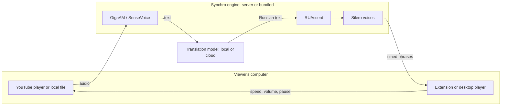

# Synchro

**Russian voiceover for English, Chinese, Korean, and Japanese video.** Synchro recognizes the original speech,
translates it, and speaks it in Russian in sync with the picture — on YouTube through a browser extension, or for
your own video files in a Windows desktop player. Speech recognition and the voices run on your own hardware; only
the recognized text goes to a translation model you choose, which can also be local.

[](LICENSE)
[](https://github.com/danifest751/synchro/actions/workflows/tests.yml)
[](https://github.com/danifest751/synchro/releases/latest)
[](https://github.com/danifest751/synchro/releases/tag/desktop-v0.1.0)

## Two ways to use it

| | [Synchro Desktop](desktop/README.md) | [Browser extension + server](docs/USER_GUIDE.md) |
| --- | --- | --- |
| Watches | Local files: MP4, MKV, AVI, MOV, WebM, HEVC, AV1… | YouTube in its native player; other sites by tab capture |
| Runs on | One Windows PC (CPU with AVX2) | Chrome or Edge, plus a Synchro server you host |
| Speech recognition and voices | Your PC's CPU, bundled in the installer | Your server (CPU, optional GPU), or the viewer's PC |
| Translation | OpenRouter, Kilo Gateway, OpenAI, or any OpenAI-compatible address | The server's local model, or OpenRouter, Kilo Gateway, OpenAI |
| Setup | Run the installer, paste a key | Deploy the server, load the extension |
| Download | [Desktop 0.1.0](https://github.com/danifest751/synchro/releases/tag/desktop-v0.1.0) (`.exe` + `.bin`) | [Latest extension release](https://github.com/danifest751/synchro/releases/latest) |

## Features

**Voiceover**
- Phrase-level timing: each Russian phrase starts with the original phrase; long phrases slow the video slightly and
  pauses play at normal speed, so speech and picture stay together.
- The original track stays audible between phrases and is smoothly lowered while the voice speaks.
- Five Russian voices (Silero V5 CIS): Albina, Alfia, Roman, Eduard, Alexander, with stress marked by RUAccent.
- Optional translated captions.

**Languages**
- English recognized by GigaAM Multilingual; Chinese, Korean and Japanese by SenseVoice-Small — both run on a CPU,
  20–50× faster than real time on a laptop. Whisper is an optional server fallback.
- The whole window of speech is translated with the previous phrases as context, then aligned back to the phrases.
- Names and numbers are rewritten for Russian speech; anything a model leaves untranslated is spelled out instead of
  stopping playback.

**Reliability**
- Translation runs about half a minute ahead; playback waits briefly instead of skipping when it falls behind.
- A failed window is retried without losing audio; seeking translates again from the new position.
- YouTube audio is fetched through the viewer's browser, so a server in a data centre needs no YouTube access of
  its own.

**Server and extension**
- Native YouTube playback with an overlay for voice, volumes, captions, zoom, fit and fill.
- Per-viewer access keys, revocation, session isolation and a concurrency limit.
- Local, cloud-text, or fully cloud processing per viewer; searchable model catalogs with live balance and
  approximate cost per minute.
- Verified extension updates from GitHub releases, and an all-in-one CPU server image.

## Quick start

### Desktop player (Windows)

1. Download `Synchro-Setup-0.1.0.exe` **and** `Synchro-Setup-0.1.0-1.bin` from the
   [desktop release](https://github.com/danifest751/synchro/releases/tag/desktop-v0.1.0) into one folder.
2. Run the `.exe` (per-user install, no administrator rights, about 3.2 GB).
3. Start Synchro, choose a translation provider and paste its key — or enter the address of a local
   OpenAI-compatible server such as LM Studio or Ollama.
4. **Open video…**, or right-click a file → **Open with → Synchro**.

Details: [desktop guide](desktop/README.md).

### Browser extension with your own server

1. `git clone https://github.com/danifest751/synchro.git`
2. Deploy the server: [deployment guide](docs/DEPLOYMENT.md). The quickest route is the
   [all-in-one CPU container](docs/DEPLOYMENT.md#all-in-one-cpu-container) with cloud text translation.
3. Load `extension/` unpacked in Chrome or Edge (Developer mode), import your `.local/connection.json` in the
   extension settings and press **Save and test**.
4. Open a YouTube video, click Synchro → **Translate tab**.

Viewers who received a configured extension from an operator only need the [user guide](docs/USER_GUIDE.md). The
public source defaults to loopback; `synchro.example.com` is a placeholder you replace when you publish your own
server.

## How it works



Audio is processed in windows of 10, then 20 seconds with a one-second overlap. Word timestamps from recognition
split speech into phrases at pauses and sentence ends; the translated window is aligned back to those phrases, and
each phrase is synthesized, loudness-normalized and returned with its start time and source duration. The player
schedules each phrase against the video clock. For YouTube, the extension also lends its network to the server:
yt-dlp's requests and the audio download run in the viewer's browser, without cookies, and only to YouTube hosts.

See [architecture](docs/ARCHITECTURE.md) for the full flow, timing rules and component map.

## What leaves your machine

| Data | Desktop | Extension + your server |
| --- | --- | --- |
| Video | Stays on your PC | Plays from YouTube in your browser |
| Audio | Stays on your PC | Goes to your server (YouTube audio is fetched through your browser) |
| Recognized text and two previous phrases | Your translation provider, or nowhere with a local model | Your server; plus your cloud provider in a cloud mode |
| API keys | Your translation provider | Your server, for the session only |

In the fully cloud mode, audio and speech also go to the chosen provider. Synchro collects no telemetry.

## Repository layout

| Path | Contents |
| --- | --- |
| [`server/`](server) | Python engine and gateway (FastAPI): recognition, translation, alignment, speech, sessions |
| [`extension/`](extension) | Manifest V3 extension: YouTube overlay, tab capture player, settings, browser relay |
| [`desktop/`](desktop) | Rust desktop player (mpv, egui) and its Windows installer |
| [`deploy/`](deploy) | Inference workers, Dockerfiles, service examples, Caddy and tunnel examples |
| [`tools/`](tools) | Configuration, client keys, packaging, extension updater, smoke tests |
| [`docs/`](docs) | User, deployment, API, architecture, cloud, models and troubleshooting guides |

## Documentation

| Document | Contents |
| --- | --- |
| [Desktop player](desktop/README.md) | Windows installer, providers, local models, troubleshooting, building |
| [User guide](docs/USER_GUIDE.md) | Extension installation, playback, voices, controls, updates |
| [Deployment](docs/DEPLOYMENT.md) | Models, services, CPU container, configuration, HTTPS, guest keys |
| [Cloud translation](docs/CLOUD.md) | Providers, API keys, model IDs, costs, HY-MT2 behavior |
| [Speech on the viewer's PC](docs/HOST.md) | Running recognition and voices next to the browser |
| [Architecture](docs/ARCHITECTURE.md) | Data flow, timing, browser relay, component map |
| [API](docs/API.md) | Authentication, endpoints, retries, response schema |
| [Models and performance](docs/MODELS.md) | Hardware, measurements, model licenses |
| [Troubleshooting](docs/TROUBLESHOOTING.md) | Connection failures, buffering, speech, YouTube |
| [Extension updates](docs/UPDATES.md) | Automatic GitHub releases and the updater |
| [Roadmap](PLAN.md) · [Changelog](CHANGELOG.md) · [Contributing](CONTRIBUTING.md) · [Security](SECURITY.md) | |

## Development

Requirements: Python 3.11+, Node.js 22+, FFmpeg; Rust stable for the desktop player. Models are not needed for the
tests.

```bash
python -m pip install -r server/requirements.txt
cd server && python -m unittest discover -s tests && cd ..
node --test tests/*.test.mjs
python -m unittest discover -s tests -p 'test_*.py'
cargo test --manifest-path desktop/Cargo.toml   # Windows
python tools/package.py                          # extension ZIP
```

A push to `main` that changes `extension/manifest.json` publishes an extension release after the tests pass; see
[contributing](CONTRIBUTING.md).

## Status and limitations

Synchro is a working prototype. Extension 0.4.6 is tested with recorded public YouTube videos in English, Chinese,
Korean and Japanese; Desktop 0.1.0 with English video files on Windows 10. Not yet covered: live
streams, private or age-restricted YouTube videos, very long sessions, and recovery from mid-video ads. Recognition
and translation can make mistakes, especially with music, overlapping voices and strong accents; phrase timing is
phrase alignment, not lip sync. Tab capture can be blocked by DRM. The desktop installer is not code-signed.

## License and acknowledgments

Synchro's source code and documentation are licensed under [MIT](LICENSE). The PCM resampler adapts MIT-licensed code
from [Avorythm](https://github.com/msmahdinejad/avorythm).

Models, voices and runtimes keep their own licenses. The desktop installer redistributes GigaAM Multilingual (MIT),
SenseVoice-Small (FunASR Model Open Source License, attribution required), Silero `v5_cis_base_nostress` (MIT) and
RUAccent (MIT), together with mpv (GPL-2.0+), FFmpeg (GPL-3.0) and a portable CPython. Other Silero releases are
under a non-commercial license and are not used. See [model notes](docs/MODELS.md) and
[third-party notices](THIRD_PARTY_NOTICES.md).

Built on [GigaAM](https://github.com/salute-developers/GigaAM), [SenseVoice](https://github.com/FunAudioLLM/SenseVoice)
via [sherpa-onnx](https://github.com/k2-fsa/sherpa-onnx), [Silero](https://github.com/snakers4/silero-models),
[RUAccent](https://github.com/Den4ikAI/ruaccent), [yt-dlp](https://github.com/yt-dlp/yt-dlp),
[FFmpeg](https://ffmpeg.org) and [mpv](https://mpv.io).
