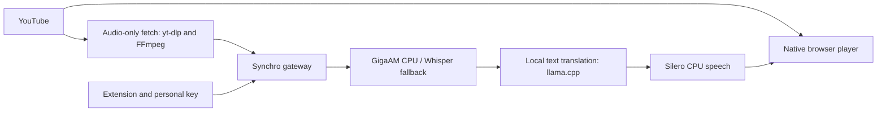

# Synchro — Local Video Dubbing

Watch English videos with synchronized Russian voiceover, powered by models on your own server.

[](LICENSE)
[](https://github.com/danifest751/synchro/actions/workflows/tests.yml)

Synchro is a Manifest V3 browser extension and a Python backend. On YouTube, video stays in the native player while the server fetches and translates the audio track. A small playback buffer gives local speech recognition, translation, and speech synthesis time to work.

**Status: prototype 0.4.3.** English → Russian is the implemented language pair. The interface and documentation are in English. This repository does not provide a hosted service, access keys, or model weights. Choose local processing, cloud text translation, or a fully cloud AI pipeline; see [cloud modes](docs/CLOUD.md). Optional [CPU speech on the browser's computer](docs/HOST.md) avoids a remote speech server. Optional [GitHub extension updates](docs/UPDATES.md) preserve installed connection settings.

## Features

- Native YouTube playback with pause, seeking, fullscreen, and an overlay for translation controls.
- Local ASR, text translation, and speech synthesis; no paid cloud API is required.
- Optional cloud text translation through OpenAI, Kilo Gateway, or OpenRouter, selected per viewer in settings.
- Searchable Kilo/OpenRouter model catalogs with translation models first, live account balance, and approximate text-translation cost per minute.
- Five Silero V5 CIS voices: Roman, Eduard, Albina, Alexander, and Alfia.
- Separate controls for original audio and voiceover, smooth audio ducking, optional captions, zoom, fit, and fill.
- Video waits when translation is not ready and slows down for longer translated phrases.
- Tab capture and a separate delayed player for other sites, using browser disk storage.
- Per-viewer access keys, revocation, session isolation, and a configurable concurrency limit.

## How it works



The reference installation uses GigaAM Multilingual 220M with eight CPU threads, Gemma 4 26B-A4B on an RTX 5060 Ti 16 GB, and Silero V5 CIS on CPU. Whisper turbo runs on a separate GPU as an ASR fallback. This is a tested configuration, not a minimum hardware requirement. Model choice and shared GPU memory determine capacity.

## Get started

If a server operator gave you a configured extension and a private connection file, follow the [user guide](docs/USER_GUIDE.md).

To run your own installation:

1. Clone this repository: `git clone https://github.com/danifest751/synchro.git`.
2. Follow [server deployment](docs/DEPLOYMENT.md) to install the inference services and generate private configuration.
3. Load `extension/` unpacked in Chrome or Edge with Developer mode enabled.
4. Import your generated `.local/connection.json` in the extension settings and select **Save and test**.
5. Open a public recorded YouTube video, finish any advertisement, click Synchro, and select **Translate tab**.

The public source defaults to loopback. `synchro.example.com` is a placeholder for an explicitly allowed self-hosted HTTPS endpoint; replace it as described in the deployment guide before distributing a remote-server build.

## Documentation

| Document | Contents |
| --- | --- |
| [User guide](docs/USER_GUIDE.md) | Installation, playback, voices, controls, updates |
| [Deployment](docs/DEPLOYMENT.md) | Models, services, configuration, HTTPS, guest keys |
| [Cloud translation](docs/CLOUD.md) | Provider selection, API keys, model IDs, testing, HY-MT2 behavior |
| [Architecture](docs/ARCHITECTURE.md) | Browser/server flow, timing, storage, component map |
| [API](docs/API.md) | Authentication, endpoints, PCM format, response schema |
| [Troubleshooting](docs/TROUBLESHOOTING.md) | Connection failures, 502, buffering, speech, YouTube |
| [Models and performance](docs/MODELS.md) | Reference hardware, measurements, model constraints |
| [Roadmap](PLAN.md) | Remaining validation and planned work |
| [Contributing](CONTRIBUTING.md) | Development, tests, packaging, changes |
| [Security](SECURITY.md) | Trust boundaries, private configuration, reporting |
| [Changelog](CHANGELOG.md) | Prototype changes |

## Development checks

Requires Python 3.11+, Node.js 22+, and FFmpeg for the audio integration tests. Models are not needed for unit tests.

```bash
python -m pip install -r server/requirements.txt
node --test tests/timeline.test.mjs
cd server
python -m unittest discover -s tests -v
cd ..
python -m unittest discover -s tests -p 'test_*.py' -v
python tools/package.py
```

## Current limitations

Public recorded YouTube videos are the primary target. Live streams, private or age-restricted videos, long sessions, unusual accents, and recovery from mid-video ads require more testing. ASR and translation can make mistakes. The extension is loaded unpacked; it does not download releases automatically or update through a browser store. Tab capture can be blocked by DRM and is limited by browser storage quota. See the user guide for capture behavior.

## License and acknowledgments

Synchro source code and documentation are licensed under [MIT](LICENSE). The PCM resampler adapts MIT-licensed code from [Avorythm](https://github.com/msmahdinejad/avorythm); its notice is retained in [THIRD_PARTY_NOTICES.md](THIRD_PARTY_NOTICES.md).

Models, voices, runtimes, and container dependencies retain their own licenses. In particular, the Silero repository's default model license includes noncommercial terms. Synchro's MIT license does not relicense those weights. Obtain the required model rights separately; see [model notes](docs/MODELS.md).
