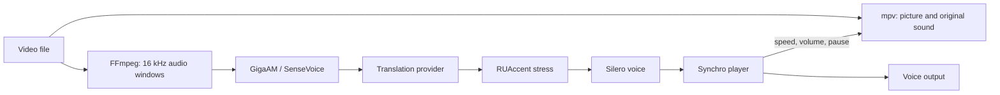

# Synchro Desktop for Windows

Watch your own video files with a synchronized Russian voiceover. Synchro Desktop is a video player (built on
[mpv](https://mpv.io)) with a speech engine that runs entirely on your computer's CPU: it recognizes the original
speech, marks Russian word stress and speaks the translation. Only the recognized **text** is sent for
translation, to the provider you choose: OpenRouter, Kilo Gateway, OpenAI, or any OpenAI-compatible address —
including a model running on your own machine.

- English, Chinese, Korean and Japanese videos.
- Five Russian voices (Silero V5 CIS): Albina, Alfia, Roman, Eduard, Alexander.
- The original track stays audible between phrases and is lowered while the voice speaks.
- Long Russian phrases slow the picture slightly so speech and video stay together; pauses play at normal speed.
- Optional on-screen captions with the translation.
- Plays practically any file mpv can play: MP4, MKV, AVI, MOV, WebM, HEVC, AV1, and more.

**Status: 0.1.0, first public build.** Tested on Windows 10 with English clips; Chinese, Korean and Japanese use
the same engine as the [Synchro server](../README.md), where they were tested end to end.

## Contents

- [Requirements](#requirements)
- [Install](#install)
- [First start](#first-start)
- [Choosing a translation provider](#choosing-a-translation-provider)
- [Watching a video](#watching-a-video)
- [What leaves your computer](#what-leaves-your-computer)
- [Performance](#performance)
- [Troubleshooting](#troubleshooting)
- [Uninstall](#uninstall)
- [How it works](#how-it-works)
- [Building from source](#building-from-source)
- [Licenses](#licenses)

## Requirements

| | Minimum | Notes |
| --- | --- | --- |
| Windows | 10 or 11, 64-bit | Per-user install, no administrator rights |
| CPU | x86-64 with AVX2 | Intel Haswell (2013) or newer, AMD Excavator/Zen (2015) or newer; 4+ cores recommended |
| Memory | 8 GB RAM | The engine peaks at about 3.5 GB while playing |
| Disk | 4 GB free | 3.2 GB installed |
| Network | For translation only | Not needed with a local OpenAI-compatible model |
| Account | A translation provider key | OpenRouter, Kilo Gateway, OpenAI, or none for a local server |

No GPU is used. Speech recognition, stress marking and voices run on the CPU.

## Install

1. Download both files of the release into the same folder:
   `Synchro-Setup-<version>.exe` and `Synchro-Setup-<version>-1.bin`. The installer is split into two files because
   the bundled models exceed 2 GB.
2. Run `Synchro-Setup-<version>.exe`. Windows SmartScreen may warn about an unsigned program; choose
   **More info → Run anyway** if you trust the download (compare its SHA-256 with `SHA256SUMS` from the release).
3. The program installs to `%LOCALAPPDATA%\Programs\Synchro` and adds:
   - a Start menu shortcut (and optionally a desktop shortcut);
   - **Open with → Synchro** for `.mp4 .mkv .avi .mov .webm .m4v .wmv .ts` files. Your default video player is not
     changed.

Everything the program needs is inside the install folder: a private Python runtime, the speech engine, the
models, FFmpeg and mpv. Nothing is installed system-wide.

## First start

1. Start **Synchro**. The window shows *Starting the speech engine…*, then *Speech engine ready*.
2. Choose a **translation provider** and paste its **API key** (see below). Settings are saved immediately.
3. Pick a **voice** and the **video language**.
4. Optionally press **Check translation**. The first check loads the speech models (about 20–30 s on a typical
   laptop); afterwards models are loaded automatically at every start, so videos open in seconds.

| Setting | Meaning |
| --- | --- |
| Translation provider | Where the recognized text is translated |
| Server address | Only for *OpenAI-compatible address*: the API base URL, e.g. `http://127.0.0.1:1234/v1` |
| Model | Leave empty for the provider's default; any model ID the provider accepts |
| API key | Required for cloud providers; optional for a local server |
| Voice | One of the five Russian voices |
| Video language | The language spoken in the video: English, Chinese, Korean or Japanese |
| Voiceover volume | Loudness of the Russian voice |
| Original volume | Loudness of the original track between phrases (it is lowered automatically during speech) |
| Captions | Show each translated phrase on screen |

Changing the voice or the language while a video plays translates again from the current position. Volumes and
captions apply immediately.

## Choosing a translation provider

| Provider | Default model | Get a key |
| --- | --- | --- |
| OpenRouter | `google/gemma-4-26b-a4b-it` | [openrouter.ai/keys](https://openrouter.ai/keys) |
| Kilo Gateway | `tencent/hy-mt2-1.8b` | [kilo.ai](https://kilo.ai) |
| OpenAI | `gpt-4.1-mini` | [platform.openai.com/api-keys](https://platform.openai.com/api-keys) |
| OpenAI-compatible address | (enter one) | Your own server or another provider |

Translation is cheap: text of a one-hour video is typically a few cents with the default models. Synchro asks for
structured JSON answers; choose a model that supports structured output (most current instruction models do).

**Using a model on your own computer.** Any server with an OpenAI-compatible `/v1/chat/completions` endpoint
works. Choose *OpenAI-compatible address* and enter, for example:

| Server | Address | Model example |
| --- | --- | --- |
| [LM Studio](https://lmstudio.ai) | `http://127.0.0.1:1234/v1` | the model ID shown in LM Studio |
| [Ollama](https://ollama.com) | `http://127.0.0.1:11434/v1` | `gemma3:12b` |
| [llama.cpp server](https://github.com/ggml-org/llama.cpp) | `http://127.0.0.1:8080/v1` | the `--alias` you started it with |

The key can stay empty for local servers. With a local model nothing leaves your computer at all.

## Watching a video

1. **Open video…** in the Synchro window, or right-click a file in Explorer → **Open with → Synchro**.
2. The mpv window opens paused and shows *Synchro: Translating ahead…*. Playback starts by itself once the first
   ten seconds are translated (a few seconds after the models are loaded).
3. Synchro keeps about half a minute of translation ahead of the picture. If translation falls behind (a slow
   provider, a long burst of speech), the video pauses briefly and continues automatically.

mpv's controls work as usual (Synchro manages the volume mix itself; use the sliders in its window):

| Key / action | Effect |
| --- | --- |
| Space, click | Pause / play |
| ← → | Seek 5 s; ↑ ↓ seek 1 min |
| Drag the seek bar | Seek; translation restarts from the new position |
| F, double-click | Full screen |
| Q | Close the video |

**Stop** in the Synchro window ends the current video. Closing the Synchro window closes the video and the engine.

## What leaves your computer

| Data | Where it goes |
| --- | --- |
| Video and audio | Nowhere. Decoded and recognized locally |
| Recognized text (and the two previous phrases for context) | Your translation provider |
| API key | Your translation provider, for each request |
| Generated speech | Nowhere. Synthesized locally |

The speech engine listens only on `127.0.0.1` with a random per-start key and stops when Synchro closes. The API
key is stored in `%APPDATA%\Synchro\settings.json` in your Windows profile, like any application setting; use a
key with a spending limit.

## Performance

Measured on a Ryzen 7 8745HS laptop (8 cores) with Kilo Gateway translation:

| Stage | Time |
| --- | --- |
| Engine start | 1–2 s |
| Loading models (once per start, in the background) | 20–30 s |
| Translating 20 s of speech (recognition + translation + alignment + voice) | 3–4 s |
| Recognition alone, 21 s window | 0.4–0.9 s (English), about 0.4 s (Chinese/Korean/Japanese) |

Playback is comfortably faster than real time on any recent 4-core CPU; most of the time is the translation
provider's response.

## Troubleshooting

| Symptom | What to do |
| --- | --- |
| *Engine failed* in the window | Open `%LOCALAPPDATA%\Synchro\engine.log` |
| *Check failed: … HTTP 401* | The API key is wrong or revoked |
| *… HTTP 402* / *credits* | Top up the provider account |
| *Custom endpoint is unreachable* | Check that your local server is running and the address ends with `/v1` |
| The video waits a lot | The provider is slow; try a faster model, or check your network |
| *This file has no readable audio track* | The file has no audio, or a codec FFmpeg cannot read |
| Wrong recognition | Set **Video language** to the language actually spoken |
| No voice, video plays | Check the Windows output device; Synchro uses the default device |

`%LOCALAPPDATA%\Synchro\player.log` records what the player did (start, seeks, waits, each phrase start), without
any text or audio. To test the engine without the player window, run from a terminal:

```powershell
& "$env:LOCALAPPDATA\Programs\Synchro\Synchro.exe" --self-test "C:\path\to\video.mp4"
Get-Content "$env:LOCALAPPDATA\Synchro\self-test.txt"
```

It starts the engine, translates the first two windows of the video and writes the result.

## Uninstall

*Settings → Apps → Synchro → Uninstall*, or *Uninstall Synchro* from the Start menu. This removes the program, the
models and the *Open with* entries. Your settings and logs stay in `%APPDATA%\Synchro` and
`%LOCALAPPDATA%\Synchro`; delete those folders to remove them too.

## How it works



- `Synchro.exe` (Rust, this folder) is the window and the player. It starts the engine and mpv as helper processes
  in a Windows job object, so both end with Synchro even after a crash.
- The engine is the [Synchro server](../server) in its desktop host mode, running in a private Python 3.12. It
  reads the file with FFmpeg in windows of 10 s, then 20 s (one second overlap), and returns phrases with their
  timing and WAV speech.
- The player asks for windows ahead of the picture, then plays each phrase when the picture reaches it: it sets
  mpv's speed so the phrase fits its source interval (0.06–16×, normally 0.75–1.0×), lowers the original track
  while the voice speaks, pauses when translation is not ready, and restarts translation after a seek.
- English is recognized by GigaAM Multilingual; Chinese, Korean and Japanese by SenseVoice-Small. Phrases are split
  by pauses and sentence ends, translated as a whole window and then aligned back to the phrases.

## Building from source

Requirements: Rust (stable), Python 3.11+, Git, and [Inno Setup 6](https://jrsoftware.org/isinfo.php). The bundle
script takes models and tools from the repository's private `.local` folder:

| Path | Contents |
| --- | --- |
| `.local/host-models/gigaam` | `config.json`, `multilingual_ctc.onnx`, `multilingual_vocab.txt` (GigaAM Multilingual CTC ONNX) |
| `.local/host-models/sensevoice` | `model.int8.onnx`, `tokens.txt` from the [sherpa-onnx SenseVoice package](https://github.com/k2-fsa/sherpa-onnx/releases/download/asr-models/sherpa-onnx-sense-voice-zh-en-ja-ko-yue-int8-2024-07-17.tar.bz2) |
| `.local/host-models/silero-cis.pt` | Silero `v5_cis_base_nostress.pt` |
| `.local/host-models/ruaccent` | RUAccent `dictionary`, `nn` and `koziev` folders (see [HOST.md](../docs/HOST.md)) |
| `.local/host-tools/ffmpeg.exe` | FFmpeg for Windows |
| `.local/host-tools/mpv` | mpv x86_64-v3 build from [shinchiro](https://github.com/shinchiro/mpv-winbuild-cmake/releases) |

```powershell
cargo test --manifest-path desktop/Cargo.toml
python desktop/build_bundle.py --test-video C:\path\to\clip.mp4   # bundle, self-test, installer
python desktop/build_bundle.py --installer-only                    # repackage desktop/dist/Synchro
```

`build_bundle.py` downloads the portable CPython 3.12 build (SHA-256 pinned), installs the CPU build of PyTorch and
[`requirements.txt`](requirements.txt) into it, copies the engine code and the files above into
`desktop/dist/Synchro` (the installed layout), builds `Synchro.exe` for x86-64-v3, runs `--self-test` on the
finished folder when a test video is given, and compiles [`installer.iss`](installer.iss) into
`desktop/dist/installer`.

For development, `cargo run --manifest-path desktop/Cargo.toml` uses the repository directly: the engine code in
`server/`, the Python environment in `.local/host-env` (`server/requirements-host.txt`), models in
`.local/host-models`, tools in `.local/host-tools` (or mpv from the `SYNCHRO_MPV` path). Debug builds keep a
console; `-- --self-test clip.mp4` prints the report there.

| Source file | Responsibility |
| --- | --- |
| `src/main.rs` | Window, settings, self-test |
| `src/engine.rs` | Engine start on loopback, job object |
| `src/api.rs` | Engine HTTP client |
| `src/player.rs` | Window fetching ahead, voice/picture synchronization |
| `src/mpv.rs` | mpv JSON IPC |
| `src/config.rs`, `src/wav.rs` | Settings file, WAV decoding |

## Licenses

Synchro's code is MIT-licensed. The installer bundles third-party software and models under their own terms,
listed in [THIRD_PARTY_NOTICES.md](../THIRD_PARTY_NOTICES.md) and [models and licenses](../docs/MODELS.md):

| Component | License |
| --- | --- |
| mpv (shinchiro build) | GPL-2.0-or-later |
| FFmpeg (gyan.dev build) | GPL-3.0 |
| CPython (python-build-standalone) | PSF and bundled library licenses |
| PyTorch, ONNX Runtime, sherpa-onnx | BSD-3-Clause, MIT, Apache-2.0 |
| GigaAM Multilingual | MIT |
| SenseVoice-Small | FunASR Model Open Source License (attribution required) |
| Silero V5 CIS Base (`v5_cis_base_nostress`) | MIT |
| RUAccent | MIT |

mpv and FFmpeg run as separate programs; their sources are available from the links in the notices.
